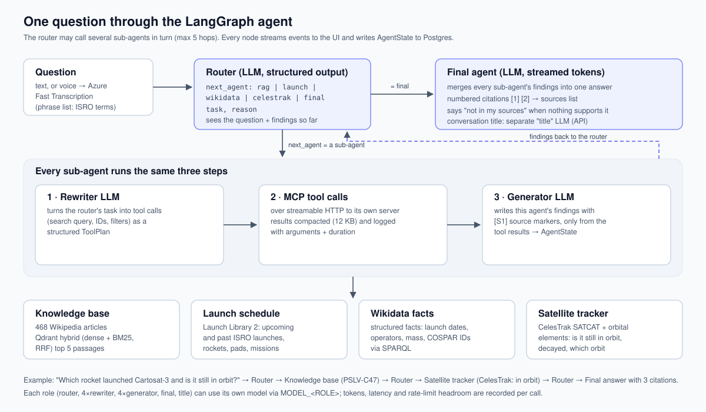

# isro agentic orchestration

LangGraph multi-agent assistant for ISRO / the Indian space programme. Text or voice in, cited answer out.
Every state change is logged to PostgreSQL for live frontend updates and replay.

```
START -> router --(next_agent)--> rag_agent | launch_agent | wikidata_agent | celestrak_agent --> router
         router --(next_agent = final_agent)--> final_agent -> END
```

| Node | LLM calls | Data |
|---|---|---|
| `router` | 1 per hop, structured output `RouterDecision {next_agent, task, reason}` | none – decides; guardrails in code (no agent twice, `MAX_HOPS`, invalid -> final) |
| `rag_agent` | rewriter (structured `ToolPlan`) + generator | `isro_knowledge_base` MCP (Qdrant RAG) |
| `launch_agent` | rewriter + generator | `launch_library` MCP (Launch Library 2) |
| `wikidata_agent` | rewriter + generator | `wikidata` MCP |
| `celestrak_agent` | rewriter + generator | `celestrak` MCP |
| `final_agent` | 1, free text, streamed | all agent contents + numbered sources |

Each sub-agent: **rewriter LLM** rewrites the router's task for its source and plans MCP tool calls ->
**tool calls** run in code (only that agent's server; one retry with feedback if empty) ->
**generator LLM** writes the content from the data, with source tags -> `{"<agent>": content}` back to the router.
Every LLM role is a separate instance with its own model setting (`MODEL_<ROLE>`) and log tag.

State (`orchestrator/state.py`): conversation `messages` (memory per `thread_id`), `question`, the router block
(`next_agent`, `task`, `reason`, `rag_agent`, `launch_agent`, `wikidata_agent`, `celestrak_agent`, `final_agent`),
`sources` per agent, `visited`, `hops`.



## Run

In the full stack this package runs **inside the API container** (`isro api` installs it as a dependency) –
`setup.ps1` / `setup.sh` at the repo root start everything. To work on the agent alone:

```
docker compose up -d                                   # Postgres :5432 + pgAdmin http://localhost:5050
cd ../isromcp && uv run python run_http_servers.py     # 4 MCP servers on :8101-8104 (Qdrant must be up)
uv sync && copy .env.example .env                      # fill in keys
uv run python examples/ask.py "When is the next ISRO launch?" --thread demo
uv run python examples/ask.py --audio tests/data/question.wav --thread demo
uv run python examples/scenarios.py
uv run pytest -q                                       # unit + live (live tests skip if services are down)
```

## Use from FastAPI (`orchestrator/service.py`)

```python
from orchestrator.service import IsroAgentService, use_selector_event_loop
use_selector_event_loop()            # Windows only, before the loop starts (psycopg async)
service = IsroAgentService()
# lifespan: await service.startup() ... await service.shutdown()

async for event in service.stream(question, thread_id):          # -> SSE / WebSocket
    ...
await service.ask(question, thread_id)                            # {answer, sources, agent_contents, ...}
await service.ask_audio(wav_bytes, "q.wav", "audio/wav", thread_id)
await service.stream_audio(...)                                   # voice + live events
await service.history(thread_id, after_id=0)                      # replay / polling from Postgres
await service.threads()
```

## Event log (PostgreSQL `agent_events`)

Append-only, ordered by `(run_id, seq)`; every event yielded by `stream()` is written first, so live and stored
sequences are identical (`token` events are streamed only; the full answer is stored in `final_answer`).

| event_type | payload |
|---|---|
| `run_started` | question, input_type (text/voice), transcript |
| `router_decision` | `structured`: next_agent, task, reason + every agent's content so far; llm timing/tokens |
| `agent_started` / `query_rewritten` / `tool_called` / `tool_result` / `agent_content` | sub-agent progress, rewritten query, tool calls, outcome, generated content + sources |
| `state_update` | the AgentState delta each node returned |
| `final_answer` | answer + numbered sources |
| `run_finished` / `error` | seconds, agents used / error |

Full AgentState snapshots per step are stored by the LangGraph checkpointer (`checkpoints*` tables).

## Decisions and gotchas

- **Today's date in every prompt** – the model otherwise assumed mid-2025 ("next launch" would be wrong).
- **Rewriter planned dependent calls** (placeholder ids) – prompt now states that calls run in parallel.
- **Windows**: psycopg async needs the selector event loop, which cannot spawn stdio subprocesses -> all MCP
  servers are used over HTTP (also better under FastAPI: no subprocess per request).
- **One event loop per process**: langchain-openai shares an async HTTP client per endpoint; run the service on
  one loop (FastAPI does). Live tests use a session-scoped loop for the same reason.
- **Speech**: Fast Transcription `api-version=2025-10-15` with a phrase list of ISRO names (corpus titles) –
  without it "Cartosat-3" became "Cardasat-3".

## Measured (gpt-6-luna for all roles)

| Scenario | Route | Time |
|---|---|---|
| Next launch + payload | router -> launch -> rag -> final | 52 s (first, cold) |
| Cartosat-3 in orbit? | router -> celestrak -> final | 16 s |
| Chandrayaan missions + dates | router -> rag -> final | 13 s |
| Out of scope (FIFA) | router -> final | 12 s |
| Follow-up "that spacecraft" | rag -> final (memory resolved) | 10 s |
| Voice: next launch + Cartosat-3 | router -> launch -> celestrak -> final | 32 s |
