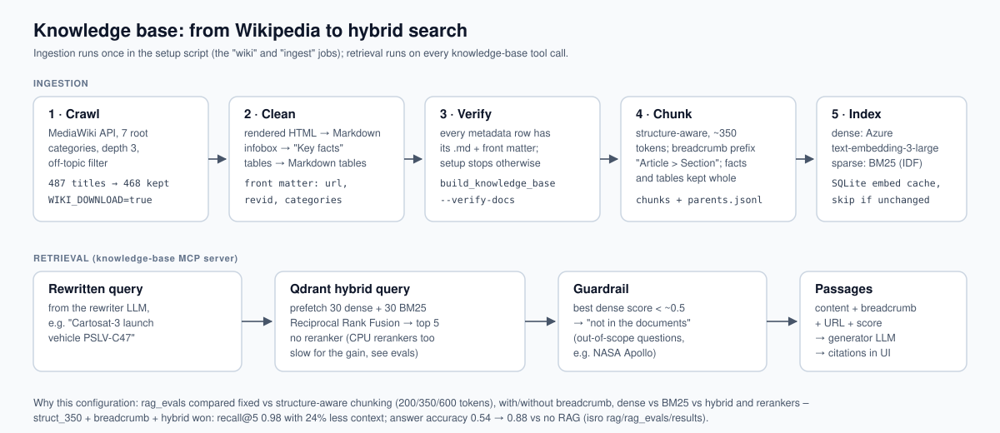

# isro rag – the knowledge base (chunking, embeddings, Qdrant)

Turns the cleaned Wikipedia articles in `../wiki documents/` into a searchable Qdrant knowledge base, and
holds the evaluation that chose its configuration (`rag_evals/`).



## What is in here

| File | Purpose |
|---|---|
| `build_knowledge_base.py` | **one command for the whole build**, used by the setup script: verify documents → chunk → index (skipped when unchanged) → verify Qdrant counts + a test query. Exits non-zero on the first failed check |
| `chunking.py` | structure-aware chunking: Markdown sections → ~350-token chunks; "Key facts" and tables kept whole; every chunk gets a breadcrumb `Article > Section`; tiny chunks merged; parent sections kept for context → `data/chunks.jsonl`, `data/parents.jsonl` |
| `embeddings.py` | dense embeddings (Azure OpenAI `text-embedding-3-large`, batched, thread-safe, SQLite cache) and BM25 sparse vectors (fastembed `Qdrant/bm25`, local CPU) |
| `index.py` | creates `isro_chunks` (named vectors `dense` + `bm25` with IDF) and `isro_parents`, uploads in batches; point ids are UUIDv5 of the chunk id, so re-indexing overwrites instead of duplicating |
| `search.py` | hybrid query: dense + BM25 prefetch, Reciprocal Rank Fusion in Qdrant (`python search.py "question"` to try it) |
| `config.py` | settings from environment variables (or a local `.env`) |
| `rag_evals/` | the A/B study: chunking variants × dense / BM25 / hybrid × rerankers, plus RAGAS end-to-end – see its README and `rag_evals/results/` |
| `tests/` | chunking + indexing tests with a fake embedder and in-memory Qdrant (no Azure keys needed) |
| `docker-compose.yml` | Qdrant alone, for working on this folder without the full stack |

## Run

With the full stack (recommended) the setup script runs this as the `ingest` job:

```bash
docker compose --profile jobs run --rm ingest                         # from the repo root
docker compose --profile jobs run --rm ingest "/app/isro rag/.venv/bin/python" build_knowledge_base.py --force
```

Standalone (Python 3.11+, [uv](https://docs.astral.sh/uv/)):

```bash
docker compose up -d                    # Qdrant on :6333 (dashboard: http://localhost:6333/dashboard)
cp .env.example .env                    # Azure endpoint/key/deployment, QDRANT_URL=http://localhost:6333
uv sync
uv run python build_knowledge_base.py   # or step by step: chunking.py, then index.py
uv run python search.py "Which rocket launched Chandrayaan-3?"
uv run pytest -q
```

## Choices (evidence in `rag_evals/results/CONCLUSIONS.md`)

- **Structure-aware 350-token chunks** – same recall@5 as 600-token chunks (0.98) with 24% less context.
- **Breadcrumb prefix is essential** – without it recall@5 falls from 0.98 to 0.75 (fact and table chunks never name their subject).
- **Hybrid dense + BM25 with RRF** – beats either alone (dense 0.93, BM25 0.88, hybrid 0.98); BM25 catches exact ids like "PSLV-C47".
- **No reranker** – CPU rerankers were slower (5–43 s/query) and not better on this corpus.
- **Out-of-scope guard** – best dense score for real questions was never below 0.51, for out-of-scope questions never above 0.50.

Data volume: 468 articles → ~3.7k chunks; embedding the whole corpus costs cents and is cached, so re-runs only embed changed chunks.
